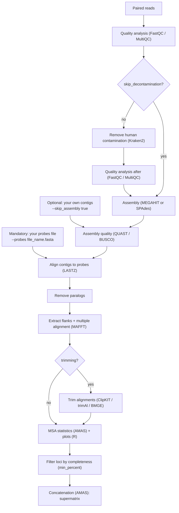

***

<p align="center">
  

  

  <h1>UCEfull</h1>
</p>

<p align="center"><b>From reads to a phylogenetic-ready supermatrix: a Nextflow pipeline to extract Ultra-Conserved Elements (UCEs).</b></p>

<p align >🚧 This pipeline is still under construction 🚧</p>

<p align >Feel free to try to use anything in here, but I make no promises that it will work as it is supposed to.</p>

<p align >Without any modifications it will only work on genotoul cluster</p>

***


# Extracting UCEs - Nextflow

French national project funded by *PEPR Dynamiques de la Biodiversité Terrestre (Dynabiod)*

## Objective

UCEfull is a bioinformatics pipeline that can be used to extract **Ultra-Conserved Elements (UCEs)** from DNA sequencing reads (or from existing assemblies) and produces a file for phylogenetic analysis (IQ-TREE, phyML...).

You do not need to know Nextflow to use it: you give it your reads (or contigs) and a probe file, and it returns alignments, quality reports and a supermatrix.

## Pipeline steps (`modules/`)

| Step | Step name | Tools | Description |
|---|---|---|---|
| 1 | Quality Control (before decontamination) | [FastQC](https://github.com/s-andrews/fastqc) & [MultiQC](https://github.com/multiqc/multiqc) | Assess read quality (read-input only). |
| 2 | Decontamination | [Kraken2](https://github.com/DerrickWood/kraken2) | Identify and remove human-classified reads; skipped with `--skip_decontamination true`. |
| 3 | Quality Control (after decontamination) | [FastQC](https://github.com/s-andrews/fastqc) & [MultiQC](https://github.com/multiqc/multiqc) | Assess read quality after decontamination (when decontamination is enabled). |
| 4 | Assembly | [MEGAHIT](https://github.com/voutcn/MEGAHIT) or [SPAdes](https://github.com/ablab/spades) | Assemble paired reads into contigs, unless existing contigs are supplied with `--skip_assembly true`. |
| 5 | Assembly Quality | [QUAST](https://github.com/ablab/quast) & [BUSCO](https://busco.ezlab.org/) | Evaluate assembly statistics and completeness of the contigs. |
| 6 | Contig-to-Probe Alignment | [LASTZ](https://lastz.github.io/lastz/) | Align contigs against the supplied fasta file of UCEs probes. |
| 7 | Paralogs Removal | awk script | Exclude loci with ambiguous or multiple contig-to-locus matches. |
| 8.1 | Multiple Sequence Alignment | Python/awk scripts, [MAFFT](https://mafft.cbrc.jp/alignment/software/) | Extract flanked sequences, align them by locus, and produce statistics and plots on the alignments. Produces the UCE summary report. |
| 8.2 | Trimming | [ClipKIT](https://github.com/jlsteenwyk/clipkit), [trimAl](https://trimal.readthedocs.io/en/latest/), [BMGE](https://gitlab.pasteur.fr/GIPhy/BMGE) | Trimming is optional. |
| 8.3 | Filtering | bash script | Filtering is optional. Keeps loci present in at least `min_percent` % of samples (minimum 2 samples). |
| 9 | Phylogenetic Format Conversion | [AMAS](https://github.com/marekborowiec/AMAS) | Convert alignments to a single phylip or nexus file adapted to phylogenetic analysis |

Outputs are published under the `outdir` directory (default: `results/`; see [Outputs](#outputs)).

## Requirements

- A SLURM cluster (default: Genotoul, queue `workq`).
- Nextflow ≥ 25.10 (tested with 26.04.6), Apptainer/Singularity and Java.
- A Kraken2 database if decontamination is enabled (default path is Genotoul-specific, override with `--kraken_db`).
- Internet access from the compute nodes for the first run: container download and `BUSCO_DOWNLOAD` (the BUSCO lineage is then cached).

## Input data

- **Reads**: a directory containing paired `.fastq.gz` files. The pair names must follow the `1`/`2` convention matched by the workflow, for example:
  ```
  clean-fastq/
  ├── ANIC00017_0101.1.fastq.gz
  ├── ANIC00017_0101.2.fastq.gz
  ├── GDEL00541_0101.1.fastq.gz
  └── GDEL00541_0101.2.fastq.gz
  ```
- **Probes**: a fasta file containing the full set of UCE probes (e.g. `probes_hymeno_assembled_wrap.fasta`).
- **Existing contigs (optional)**: when using `--skip_assembly true`, provide a directory containing one or more `.fasta` files with the contigs for each sample.


> **Note:** this pipeline does not trim input reads. Adapter and quality trimming must be performed beforehand (for example, with Trimmomatic, Fastp or Illumiprocessor).

## Installation and usage 

These are commands for Genotoul cluster

```bash
git clone https://github.com/Madeline38/extracting_UCEs_nextflow.git
cd extracting_UCEs_nextflow
module purge
module load devel/java/24.0.2
module load bioinfo/Nextflow/26.04.6
module load containers/Apptainer/1.4.1
nextflow run main.nf --reads [raw_data] --probes [probes_file] [OPTION]
```


### Run on Genotoul (recommended: through a SLURM job)

Do not run `nextflow run` directly on the login node. Create `run_pipeline.sh` (changing the file names according to yours):

```bash
#!/bin/bash
#SBATCH -J uce_pipeline
#SBATCH -p workq
#SBATCH -t 2-00:00:00
#SBATCH --cpus-per-task=1
#SBATCH --mem=5G
 
module load devel/java/24.0.2
module load bioinfo/Nextflow/26.04.6
module load containers/Apptainer/1.4.1
 
nextflow run main.nf \
  --reads reads_dir \
  --probes probes_hymeno_assembled_wrap.fasta \
  --outdir results
```

Then submit it with `sbatch run_pipeline.sh`. Progress is written to `slurm-<job-id>.out`.


### Start from existing contigs
 
```bash
nextflow run main.nf \
  --skip_assembly true \
  --contigs contigs_dir \
  --probes probes_hymeno_assembled_wrap.fasta \
  --outdir results
```

> Use an `--outdir` **different from** the `--contigs` directory. Otherwise the pipeline republishes contigs onto themselves and can break the symbolic links.

### Resume an interrupted run
 
Repeat the same command and add `-resume`. Completed tasks are reused.

## Parameters (`nextflow.config`)

Parameters are set in `nextflow.config`.

| Parameter | Default value | Description |
|---|---|---|
| `reads` | `null` | Directory containing paired, compressed FASTQ reads. Required unless `--skip_assembly true` is used. |
| `skip_decontamination` | `false` | Set to `true` to skip human-read decontamination when starting from reads. |
| `kraken_db` | `'/bank/kraken/k2_pluspfp_20251015'` | Path to the Kraken2 database used for decontamination. This default is environment-specific. |
| `keep_kraken_output` | `false` | Keep the large intermediate files produced by Kraken2 during the decontamination step. Enabling this preserves more cached data, which speeds up reruns with -resume, but requires significant disk space. By default, these files are deleted. |
| `skip_assembly` | `false` | Set to `true` to skip read processing and assembly and use existing contigs instead. |
| `contigs` | `null` | Directory containing input contig FASTA files. Required when `--skip_assembly true` is used; the workflow looks for `*.fasta` files. |
| `type_assembly` | `megahit` | Assembler to use: `megahit` or `spades`. |
| `busco_db` | `hymenoptera_odb12` | BUSCO lineage database used to assess assembly completeness. |
| `probes` | `null` | FASTA file of UCE probes. Required in both execution modes. |
| `flank` | `8000` | Number of bases to extract on each side of a matched UCE. |
| `min_percent` | `0` | Minimum percentage of samples in which a locus must be present to retain it (0–100). At least two samples are required for a locus to be retained. |
| `trimming` | `none` | Optional alignment trimming. clipKIT, bmge and trimAl are available; default is no trimming. |
| `mode_clipkit` | `kpic` | ClipKIT mode, used only with `--trimming clipkit`. |
| `phylogenetic_format` | `phylip` | Output alignment format: `nexus` or `phylip`. |
| `outdir` | `results` | Output directory name. |


## Outputs

```
results/
├── Etape_1_analyses/                       # FastQC / MultiQC before decontamination
├── Etape_2_decontamination/                # Kraken2 reports, cleaned reads, contamination summary
├── Etape_3_analyses_post_decontamination/  # FastQC / MultiQC after decontamination
├── Etape_4_assemblage/                     # contigs and assembly logs
├── Etape_5_analyses_assemblage/            # QUAST and BUSCO
├── Etape_6_alignment_probes_contigs/       # LASTZ results
├── Etape_7_remove_paralogs/                # filtered SAM files and paralog reports
├── Etape_8_alignments/
│   ├── flanked/                            # flanked sequences per sample
│   ├── loci/                               # sequences grouped by locus
│   ├── mafft/all/                          # raw MAFFT alignments
│   ├── trimmed/                            # trimmed alignments (only if trimming is used)
│   ├── mafft/filtered/                     # alignments kept after min_percent filtering
│   └── stats/                              # AMAS summary table and figures
├── Etape_9_final_files/                    # UCE summary, nexus/phylip per locus, supermatrix
└── pipeline_info/                          # Nextflow report, timeline and trace
```
Some folders are empty when the corresponding step is skipped.

### Where to look first after the run

| File | What it tells you |
|---|---|
| `Etape_2_decontamination/contamination_report.html` | Share of human reads before cleaning, reads removed, and whether decontamination worked. |
| `Etape_1_analyses/multiqc/`, `Etape_3_…/multiqc/` | Summary of all your reads quality. |
| `Etape_5_analyses_assemblage/` (QUAST, BUSCO) | Assembly quality. |
| `Etape_7_remove_paralogs/remove_paralogs_report.html` | Number of loci per sample before and after removing paralogs. |
| `Etape_8_alignments/stats/msa_stats_*.png` | Distribution of alignment length, variable sites, missing data, and PCA of loci. |
| `Etape_9_final_files/uce_summary.html` | Number of loci kept and samples per locus. |
| `Etape_9_final_files/supermatrix.*` supermatrix file | Input for the phylogenetic analysis. |
| `pipeline_info/report.html` | Real CPU and memory used by each step (you can adapt it in nextflow.config according to your needs). |

### Next step: build a tree

Take the final supermatrix file and let’s start building your phylogeny! Don't hesitate to use integrative methods for more secure results.

## Notes from previous runs

- The number of reads removed during decontamination depends on the Kraken2 database and the samples.
- SPAdes took substantially longer than MEGAHIT. Runtime and assembly quality depend on the dataset and available resources; benchmark both assemblers for your data if needed.
- Alignment trimming is optional (`--trimming clipkit`). Compare trimmed and untrimmed alignments to decide whether trimming is appropriate for your data.
- Nextflow can reuse cached tasks with `-resume` when task inputs and outputs are available. The decontamination process removes its Kraken2 output file after read extraction, so this intermediate file is not retained. Keeping it would require modifying the decontamination process and would consume additional disk space.

## Resources

As an example, a previous run with 21 shotgun samples, decontamination and MEGAHIT assembly took about 17 hours 42 minutes and used approximately 500 GB of disk space. These figures are dataset- and cluster-specific; actual resource requirements may differ substantially.

## Learning more

If you want to get familiar with Nextflow and understand each process in this pipeline: [training.nextflow.io](https://training.nextflow.io/latest/hello_nextflow/)

## Citation

If you use this tool for your analyses, please don't forget to cite this GitHub repository.

## Author

Madeline GUENE

<div>
  
    &nbsp;&nbsp;&nbsp;&nbsp;
  
</div>


## Workflow
 



